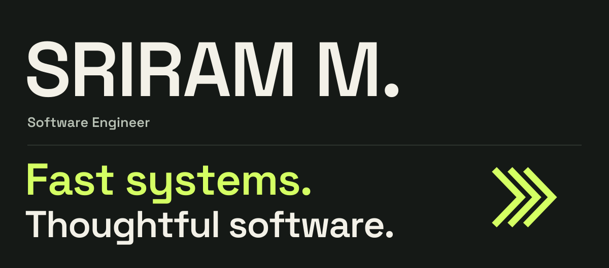
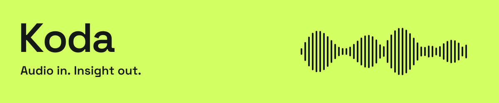
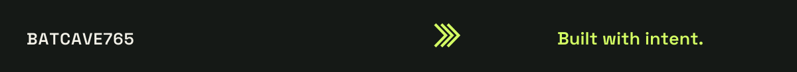

<picture>
  <source media="(max-width: 600px)" srcset="assets/hero-mobile.svg">
  
</picture>

  <a href="#things-ive-built"><strong>Explore my work ↓</strong></a>
  &nbsp;&nbsp; / &nbsp;&nbsp;
  <a href="https://www.linkedin.com/in/sriram-m765/"><strong>LinkedIn ↗</strong></a>
  &nbsp;&nbsp; / &nbsp;&nbsp;
  <a href="mailto:msriram765@gmail.com"><strong>Let's talk ↗</strong></a>

## I care about what happens under the surface.

I'm **Sriram**, a software engineer in **Chennai, India**. I work across performance engineering, full-stack applications, and mobile experiences — from finding bottlenecks in distributed systems to making a local-first app feel instant.

At **Cognizant**, I build performance testing frameworks and developer automation for **Macy's supply chain**. In my own projects, I work with **Go, TypeScript, React Native, and Next.js** to explore fast storage, audio analysis, and thoughtful interfaces.

**The thread through my work:** understand the system, remove the friction, and make the result feel effortless.

 

## Things I've built

### [Koda ↗](https://github.com/Batcave765/Koda)

A music analysis application that turns uploaded audio into **BPM and musical key**. A Go engine handles the analysis; a Next.js interface makes it approachable.

- Implemented **Krumhansl–Schmuckler key detection**, with FFT math and chroma mapping using Gonum.
- Built the API with **Gin** and integrated **FFmpeg** for server-side audio conversion.
- Connected a **Next.js 15** frontend and packaged the services with **Docker and Docker Compose**.

`Go` `Gin` `Gonum` `Next.js` `TypeScript` `Tailwind CSS` `FFmpeg` `Docker` `Bun`

 

### Recur

A local-first subscription tracker built around a simple expectation: **your everyday actions should feel immediate**.

- Built with **React Native, TypeScript, and Expo 54**, with the New Architecture enabled.
- Used **MMKV's C++ JSI bindings** for fast local storage without the standard asynchronous bridge overhead.
- Validated data at the read/write boundaries with **Zod** and crafted interactions with **Reanimated, NativeWind, and Radix UI primitives**.

`React Native` `Expo` `TypeScript` `MMKV` `Zod` `Reanimated` `NativeWind`

Project described in my resume; a public source repository isn't linked here yet.

 

**More to explore:** [NeerSuraksha](https://github.com/Batcave765/SIH), a social-media-based disaster management application · [CodeFormatter](https://github.com/Batcave765/CodeFormatter) · [All repositories ↗](https://github.com/Batcave765?tab=repositories)

 

## Where I've put it to work

### Cognizant Technology Solutions

**Performance & Automation Engineer** · February 2025–present · Chennai 
Client: Macy's Supply Chain

- Develop and maintain **k6 testing frameworks** for order creation, returns, and refunds on the Unified Orders Platform.
- Analyze microservice behavior under **3,000 TPS** workloads using **GCP container logs, Grafana, and Dynatrace**, tracing architectural and database bottlenecks.
- Built a **self-service developer tool inside GitLab CI/CD** to automate test execution and dynamic reporting.
- Created **Python log-processing automation** that saves **3–4 hours of manual work per release cycle**.

### DevCrew

**Web Development Intern** · May–July 2023 · Coimbatore

Built frontend features and refactored **React and Next.js** components for client projects. Investigated runtime bugs and interface regressions to improve stability and usability.

 

## My working toolkit

The technologies I've used across professional work and personal projects.

| Area | Technologies |
| :--- | :--- |
| **Languages** | TypeScript · Go · JavaScript · Python · Java · C · C++ · SQL |
| **Web & UI** | React · Next.js · Tailwind CSS · Radix UI |
| **Mobile** | React Native · Expo · NativeWind · React Native Reanimated · MMKV · JSI |
| **Backend & data** | Gin · Spring Boot · SpacetimeDB · Drizzle ORM · MySQL · MongoDB · Zod |
| **Performance & observability** | k6 · Grafana · Dynatrace · Elasticsearch · GCP container logs |
| **Delivery & developer tools** | GitLab CI/CD · Docker · Docker Compose · Git · Bun · Postman |
| **Audio & signal processing** | FFmpeg · Gonum · FFT · Chroma mapping · Musical key detection |

<strong>The engineering ideas behind the tools</strong>

 

- **Performance:** load testing, high-concurrency behavior, microservice diagnostics, and bottleneck analysis.
- **Developer experience:** self-service tooling, repeatable CI workflows, log parsing, and automated reporting.
- **Application architecture:** local-first persistence, schema validation, type-safe data boundaries, REST APIs, and multi-service applications.
- **Interface craft:** responsive layouts, mobile interactions, accessible primitives, and frontend debugging.
- **Audio analysis:** decoding, frequency transforms, chroma representations, tempo, and key estimation.

 

## A little more about me

**B.Tech in Information Technology** · Sri Krishna College of Engineering and Technology, Coimbatore · 2021–2025

- **Second Runner-up, national** — Innohacks '22, KIET Group of Institutions / Innogeeks, New Delhi · May 2022
- **Most Impactful Hack, national** — Hack @ SKCET, Hackclub SKCET, Coimbatore · February 2022

 

---

### Have a system to improve or a product to build?

I'd love to talk about software engineering, performance, and building useful things.

**[Email me ↗](mailto:msriram765@gmail.com)** &nbsp; · &nbsp; [Connect on LinkedIn](https://www.linkedin.com/in/sriram-m765/) &nbsp; · &nbsp; [Explore my repositories](https://github.com/Batcave765?tab=repositories)

 

