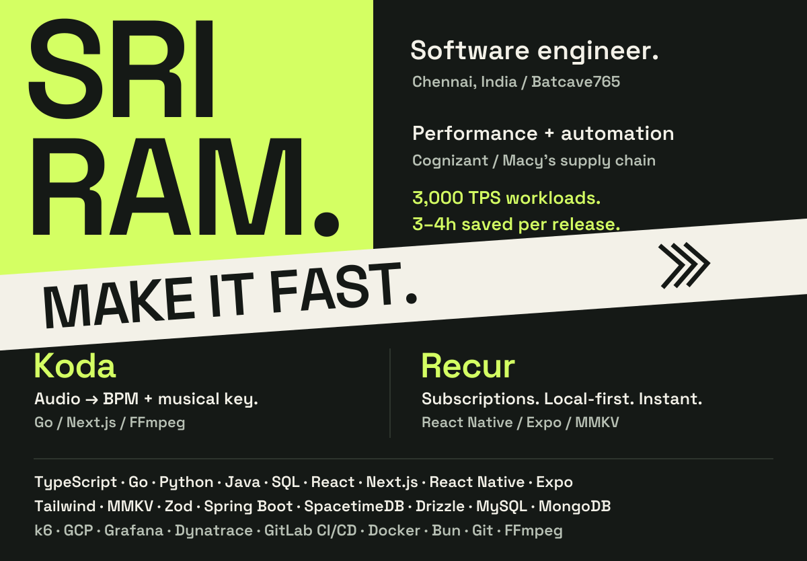

<picture>
  <source media="(max-width: 600px)" srcset="assets/profile-mobile.svg">
  
</picture>

  <a href="https://github.com/Batcave765/Koda"><strong>Koda ↗</strong></a> &nbsp; / &nbsp;
  <a href="https://github.com/Batcave765?tab=repositories"><strong>Code ↗</strong></a> &nbsp; / &nbsp;
  <a href="https://www.linkedin.com/in/sriram-m765/"><strong>LinkedIn ↗</strong></a> &nbsp; / &nbsp;
  <a href="mailto:msriram765@gmail.com"><strong>Email ↗</strong></a>

